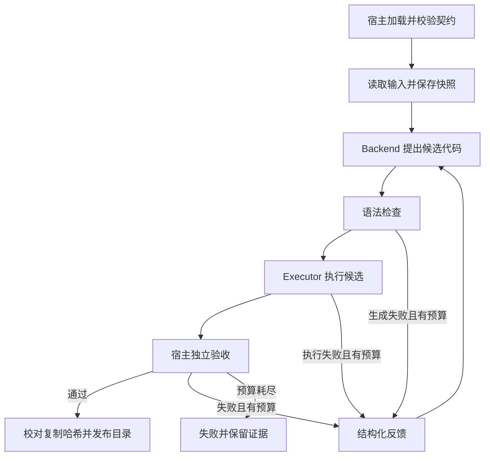

# 架构、状态机与信任边界

## 一次任务的流程

## 核心接口

- `CodeBackend.propose(ProposalContext) -> Generation`：输入契约、样例、旧代码与反馈；输出代码提案。
- `Executor.execute(program, input_dir, output_dir, limits) -> ExecutionResult`：执行候选并记录退出码、时限和日志。
- `verify(source_snapshot, contract, artifact_dir) -> VerificationResult`：不调用模型，检查结构与业务结果。
- `Harness.run(...) -> RunResult`：组织状态转换、修复次数和发布。

这是同步、单任务的最小运行器；网络请求和子进程执行也是同步等待。首版没有 asyncio、多任务调度或分布式能力。

## 状态转换

`CREATED → GENERATING → EXECUTING → VALIDATING → PASSED` 是成功路径。

生成、执行、验收任一阶段的候选错误都可进入 `REPAIRING → GENERATING`；用尽 `max_attempts` 后进入 `FAILED`。`TRANSITIONS` 明确限制合法边。基础设施异常返回 CLI 错误码 2，并保留已经写出的记录；首版不承诺每一种磁盘/进程故障都能写完终态。

## 如何独立

候选程序与验证器使用不同实现。`source.expected_artifacts` 是宿主 oracle；worker 不导入这个函数。Docker 只获得本次原始输入、契约和自身代码的只读挂载，以及候选输出目录的写权限，不挂载项目源码、测试或期望结果。

宿主先保存输入字节快照，验收依据这份快照与已加载契约。模型给出的汇总、退出码及解释都不是成功判据。

## 发布语义

每次候选有独立的 `attempts/NNN/artifacts`。验收通过后，宿主将三份结果复制到同一工作目录中的临时发布目录，逐文件核对已验收哈希，写入宿主 manifest，最后执行目录重命名。

这可以避免正常运行过程中交付一半结果。它没有实现断电级事务、目录 fsync、跨文件系统原子提交或崩溃后自动恢复。JSONL 与文件哈希提供追踪信息，不提供数据库事务或防篡改签名。

## 固定 ETL 能做，为什么还需要模型？

`orders.v1` 的规则足够明确，宿主 oracle 本身就能算出正确结果，因此这个具体任务完全可以使用固定 ETL。我们选择它作为第一版实验任务，是为了检查 Harness 的失败识别、反馈和发布机制，而不是证明 LLM 比 ETL 更高效。

后续可研究用户提出新字段映射和转换目标时的程序生成：先人工确认任务契约与验证条件，再让模型提出实现。新增业务仍需独立验证器；首版不提供任意自然语言任务的正确性保证。
